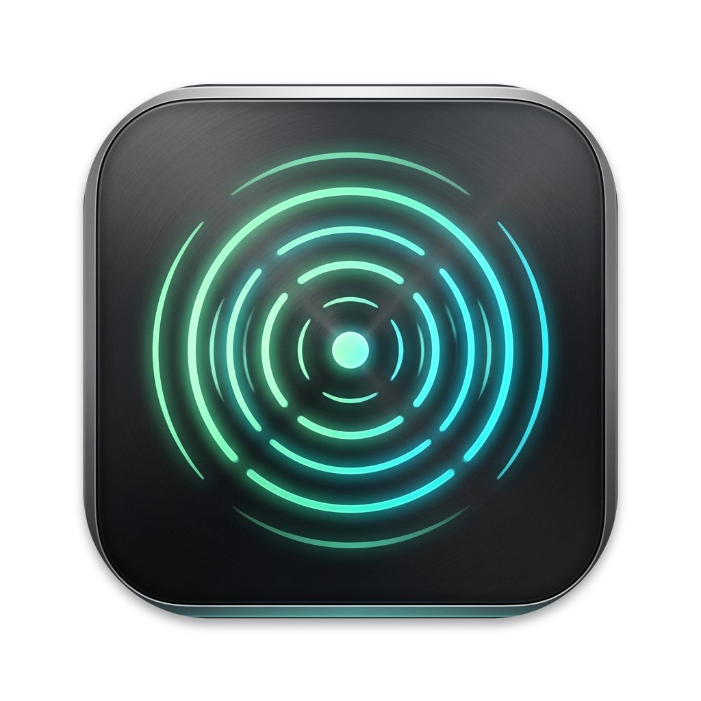

# TapThatX



A native macOS menu bar app that turns deliberate double taps and knocks into actions. Built with Swift, SwiftUI and AppKit; no third-party package dependencies.

The current on-Mac detection is the working POC baseline. Set one **Double-tap action** in Actions: Ring, Lock Mac, media controls, or an experimental ChatGPT control. Existing lock, quick-action and assistant preferences migrate automatically. Triple-tap recognition is disabled in production.

Ring reveals every action. A single tap advances clockwise after the double-tap window; a double-tap chooses the highlighted action without advancing first. The default window is 450 ms and calibration can extend it to match a slower natural cadence. Right/Down and Left/Up cycle in opposite directions and wrap around. Return chooses, Escape cancels, and pointer selection works too. The ring starts with Play / Pause selected. Preview responds to the same gestures while actions remain paused. Direct Lock Mac and Play / Pause show the ring, swing the highlight to the command, and animate a press before executing (about 620 ms total). Choosing an action in the open ring shows a 220 ms press before execution. Escape or losing focus cancels the pending action. Trackpad haptic feedback acknowledges the request on supported hardware; a confirmation appears after unlocking when macOS confirmed the lock. macOS may cover the ring as soon as the screen locks.

A quiet chime acknowledges each confirmed ring choice, including automatic Lock Mac and Play / Pause. Hovering and moving the highlight remain silent. Confirmation keeps the ring steady and emphasizes the center icon without restarting the highlight's motion; the chime acknowledges the choice, not successful execution.

The ring uses Apple's native Liquid Glass material (NSGlassEffectView) on macOS 26 and newer, so it inherits the macOS 27 Liquid Glass refinements automatically, and the same glassy, blurred AppKit material on macOS 14 and 15. Reduce Motion and Reduce Transparency are respected.

## Develop

Requires an Apple Silicon Mac, macOS 14+, and Xcode 16 or newer with a Swift 6 toolchain. The package deliberately uses Swift 5 language mode. Sensor support depends on the Mac's accelerometer and permissions; compiling does not establish hardware compatibility.

```sh
swift build
swift test
swift build -c release
open Package.swift
```

Open `Package.swift` in Xcode for editing and debugging. Use the bundled app for permission and helper testing; the command-line executable does not reproduce its signing identity or resources.

```sh
bash scripts/build-app.sh
open dist/TapThatX.app
```

Create `scripts/signing.env` (git-ignored) with your identity and team, and the build picks it up:

```sh
SIGNING_IDENTITY='Apple Development: Your Name (CERTIFICATE_ID)'
TEAM_ID='YOURTEAMID'
```

Explicit environment variables still override the file. Use a consistent signing identity and installation path to retain macOS permission grants. Supply your own certificate and team. Omitting them produces an ad-hoc development bundle that cannot use the signed helper. After a successful build the script replaces `/Applications/TapThatX.app` with the fresh bundle; set `SKIP_APP_INSTALL=1` to skip that install.

See [Contributing](CONTRIBUTING.md) for the development loop and [distribution](docs/DISTRIBUTION.md) for packaging.

## Try the baseline

The Permissions page opens on launch when access is missing and provides buttons for the relevant System Settings pages. Grant Accessibility and Input Monitoring when prompted on launch. Accessibility enables system actions; Input Monitoring enables suppression near typing. Direct sensor access is tried first; the signed helper may require approval in System Settings.

1. Open **Setup & Diagnostics** and keep **800 Hz** for the current detection baseline.
2. Watch the graph while tapping twice. Actions are paused while settings are visible.
3. In **Actions**, set **Double-tap → Ring**, enable actions and close settings. Double-tap to open, tap to move, and double-tap to choose.
4. After a missed interaction, immediately choose **Save last 15 seconds** from the menu.

The recent export includes bounded XYZ samples, key timestamps and diagnostic events. It saves locally under `~/Library/Application Support/TapThatX/`; it contains no typed characters or microphone recording and is never uploaded. Unsaved context is lost on quit. Calibration recordings also disable actions while recording. Simulated input always uses dry-run actions.

Lower sampling rates remain experimental; below 50 Hz is monitoring only. Reliable desk detection, left/right classification, broad hardware coverage and significant whole-app CPU savings at lower rates are not established. The graph displays motion, not proof that every peak qualifies as a gesture.

## Personal calibration

Use the first-run calibration or choose **Calibrate…** in Tap Tuning. Calibration takes over the settings window and asks for four gestures only: one light tap, two light taps, one natural tap, and two natural taps. There are no setup fields, background exercises, review forms, or manual confirmation screens. Valid gestures advance automatically and the resulting profile is applied automatically.

Each gesture window includes a short pre-cue baseline and a 2.5-second response period. The app fits amplitude, onset-speed, pulse-duration, and double-tap-cadence settings that preserve the four requested gestures without accepting extra impacts around them. Collection still rejects missing or delayed samples, interrupted sessions, typing over the gesture, and incorrect contact counts. If no profile qualifies, existing settings stay unchanged and the focused flow offers a retry.

Sessions are saved locally under `~/Library/Application Support/TapThatX/Calibration/` with unique filenames and per-gesture checkpoints. No old recordings are used, and nothing is uploaded. A short calibration personalizes detector settings; it does not establish general detection accuracy. See the [design and limits](docs/DETECTION-CALIBRATION.md).

## Layout

| Path | Purpose |
| --- | --- |
| `Sources/TapCore` | Sensor decoding, buffered input, pulse detection, gesture routing, replay and shared models |
| `Sources/TapThatX` | Menu bar app, settings, graph, command ring and action execution |
| `Sources/TapSensorHelper` | Authenticated sensor helper |
| `Sources/SensorProbe` | Read-only hardware diagnostic executable |
| `Sources/ReplayCaptures` | Labeled recording replay CLI |
| `Tests/TapCoreTests` | Deterministic generated-signal, collection, calibration and interaction tests |
| `Packaging` | Bundle metadata, app/menu icons and DMG artwork |
| `scripts` | Validation, app bundling and distribution |

[First-principles detection and calibration](docs/DETECTION-CALIBRATION.md) describes the design, implemented quality checks, and remaining algorithm experiments. Historical captured fixtures and their accuracy claims have been removed.

## Attribution

Sensor report decoding and initialization were informed by [apple-silicon-accelerometer](https://github.com/olvvier/apple-silicon-accelerometer). Its [MIT notice](docs/SENSOR_REFERENCE_LICENSE.txt) is preserved and bundled. This notice applies to the referenced work; this repository does not declare a project-wide open-source license.
