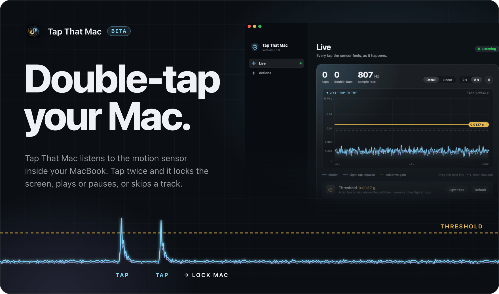
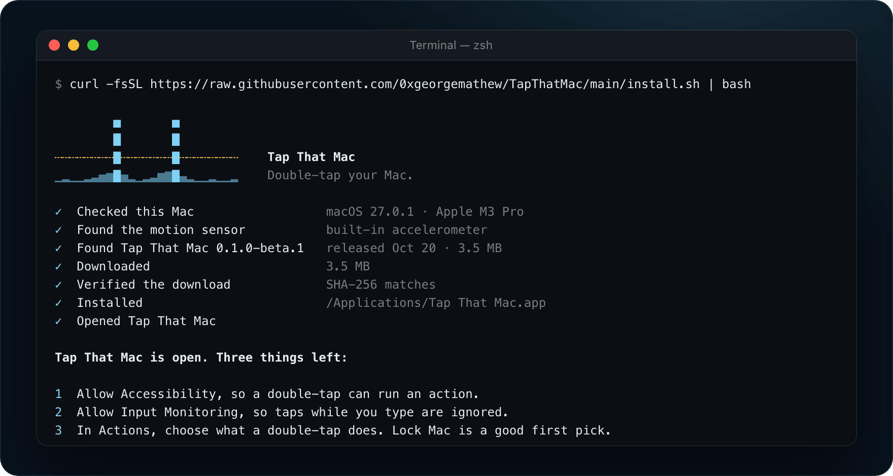
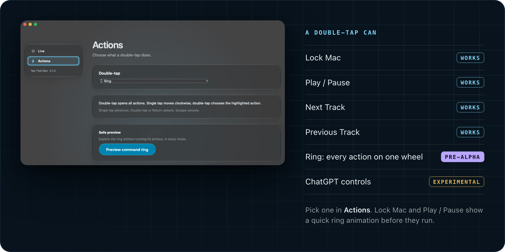
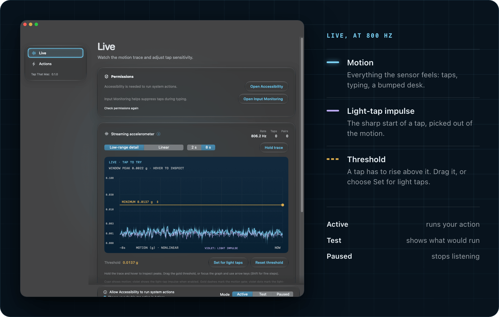
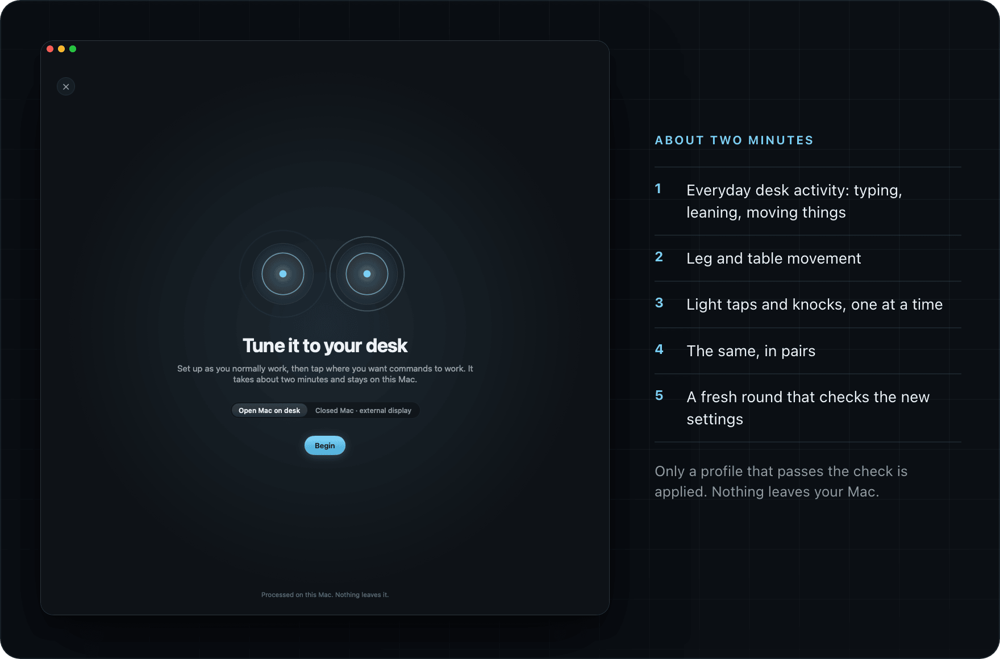
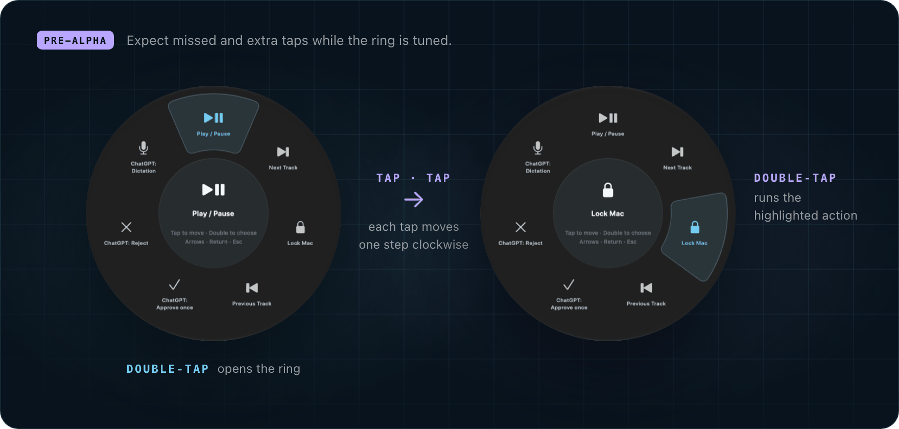

<p align="center">
  
</p>

<p align="center">
  <a href="https://github.com/0xgeorgemathew/TapThatMac/releases"></a>
  
  
  <a href="LICENSE"></a>
</p>

<p align="center">
  Your MacBook has a motion sensor it never tells you about. Tap That Mac listens to it,<br>
  so <b>two quick taps on your Mac or desk can lock the screen, play or pause, or skip a track.</b>
</p>

<br>

> [!NOTE]
> **Double-tap to run one action works today.** The command ring, where single taps move around a wheel of actions, is **pre-alpha**. It's in the app and you can try it, but expect missed and extra taps while it's tuned. [More on the ring ↓](#the-command-ring-pre-alpha)

## Install

Paste this into Terminal:

```sh
curl -fsSL https://raw.githubusercontent.com/0xgeorgemathew/TapThatMac/main/install.sh | bash
```

It checks that your Mac has the motion sensor, downloads the latest release, verifies its checksum, installs **Tap That Mac** in Applications and opens it.

You'll need a **MacBook with Apple silicon** on **macOS 14 or later**. Desktop Macs don't have the sensor.



<details>
<summary>Prefer to drag and drop?</summary>

<br>

Download `TapThatMac-<version>.dmg` from [Releases](https://github.com/0xgeorgemathew/TapThatMac/releases) and drag the app to Applications. The app is signed but not notarized, so the first time macOS will say it can't check it. Open **System Settings › Privacy & Security** and choose **Open Anyway**, or run:

```sh
xattr -dr com.apple.quarantine "/Applications/Tap That Mac.app"
```

That clears the download flag for this one app. It doesn't turn off Gatekeeper.
</details>

<br>

## How to use it

**1. Give it two permissions.** On first launch, the **Live** view lists what's missing and opens the right page in System Settings. Turn on Tap That Mac in each list.

| Permission | Why |
| --- | --- |
| **Accessibility** | Lets a double-tap lock the screen, control media or press a ChatGPT button. |
| **Input Monitoring** | Lets it ignore taps that land while you're typing. It looks only at key timing, never at what you type. |

**2. Choose what a double-tap does.** Open **Actions** and choose one. **Lock Mac** is a good first choice.

**3. Tap twice.** Two light, quick taps on the palm rest, the lid or the desk beside it. Keep the Live view open the first few times to see each tap rise above the gold line.

**4. If it misses taps or triggers on its own, calibrate.** Two minutes, covered [below](#tuned-to-your-desk).

<br>

## One double-tap, one action



Pick a single action for a double-tap. **Lock Mac**, **Play / Pause**, **Next Track** and **Previous Track** work today. Before Lock Mac or Play / Pause runs, a ring flashes up and highlights it, so you can see what your taps did. A quiet chime and a trackpad tick confirm it; press Escape in that moment to cancel.

The **ChatGPT controls** (Approve once, Reject, Dictation) press the matching button on the ChatGPT page you have open. They're experimental.

## See every tap



The **Live** view draws the sensor 800 times a second. **Cyan** is all motion. **Violet** picks out the sharp start of a light tap. The **gold** line is the threshold a tap has to cross: drag it down if your taps don't register, up if bumps set it off, or choose **Set for light taps**.

The mode switch at the bottom of every view decides what happens:

- **Active** runs your action.
- **Test** shows what it recognized without running anything. Use it while you get a feel for it.
- **Paused** stops listening and stops reading the sensor.

## Tuned to your desk



Every desk feels different. Choose **Calibrate…** in Live, pick **Open Mac on desk** or **Closed Mac · external display**, and follow along for about two minutes. It records ordinary desk activity first, then your own taps and knocks, singly and in pairs, and finishes with a fresh round that checks the new settings. A profile is applied only if it passes that check; if calibration fails, your current settings stay. Keep one profile per setup and switch between them as you move. Lap use isn't supported.

<br>

## The command ring (pre-alpha)



Set the double-tap to **Ring** and every action sits on a wheel:

- **Double-tap** opens the ring.
- **Tap** moves the highlight one step clockwise.
- **Double-tap** again runs the highlighted action.
- Arrow keys, Return, Escape and the pointer work too.

> [!WARNING]
> **The ring is pre-alpha.** Telling a single tap from a double depends on timing (450 ms by default, and calibration can stretch it), and that isn't reliable yet. Expect the highlight to skip a step, miss a tap, or choose too early. To try it without consequences, use **Actions › Preview command ring**: it never runs anything. Bug reports with your Mac model and where you tapped are very welcome.

<br>

## Private by design

- **Nothing leaves your Mac.** Tap That Mac has no network code: no analytics, no accounts, no update checks.
- **It reads motion, not keystrokes.** Input Monitoring is used only to learn *when* a key was pressed, so taps during typing can be ignored.
- **Your calibration stays local**, in `~/Library/Application Support/Tap That Mac/`.
- **No third-party code.** Swift, SwiftUI and AppKit, with no package dependencies.

## Update or remove

Run the install command again to update. Your settings and calibration are kept.

To remove Tap That Mac:

```sh
curl -fsSL https://raw.githubusercontent.com/0xgeorgemathew/TapThatMac/main/install.sh | bash -s -- --uninstall
```

Add `--purge` to also delete your settings and calibration and reset its permission grants. Use `--version v0.1.0-beta.1` to install a specific release.

<details>
<summary>Coming from TapThatX?</summary>

<br>

Tap That Mac is the new name. On first launch it copies your old preferences and calibration from TapThatX, and leaves the originals where they were. macOS treats it as a new app, so approve Accessibility and Input Monitoring once more, then delete the old app. See [upgrade details](docs/DISTRIBUTION.md#upgrading-from-the-previous-name).
</details>

## What's not known yet

Tap That Mac is a beta and hasn't been tried on many Macs yet. Some MacBooks may read the sensor differently. It hasn't been proven reliable on every kind of desk. It can't tell left taps from right taps. The graph shows motion, and a spike above the line is not always a tap. If yours misbehaves, [open an issue](https://github.com/0xgeorgemathew/TapThatMac/issues) with your Mac model, macOS version and where you tapped.

<br>

## Build from source

Requires Xcode 26 or newer: the app uses the macOS 26 SDK for Liquid Glass and falls back to older materials on macOS 14 and 15. The package uses Swift 5 language mode.

```sh
swift build && swift test         # build and run the test suites
bash scripts/check.sh             # what CI runs
bash scripts/build-app.sh         # sign and install dist/Tap That Mac.app to /Applications
bash scripts/release.sh 0.1.0-beta.1   # zip, checksum and DMG for a GitHub release
```

`build-app.sh` reads `SIGNING_IDENTITY` and `TEAM_ID` from the environment or the git-ignored `scripts/signing.env` (copy `scripts/signing.env.example`). Without them you get an ad-hoc build that can read the sensor directly but can't use the signed helper. The README images are rendered from real window captures with `python3 -I scripts/readme-media.py`.

| Path | What's there |
| --- | --- |
| `Sources/TapCore` | Sensor decoding, tap detection, gesture routing, calibration and replay |
| `Sources/TapThatMac` | The app: Live and Actions views, graph, command ring, action execution |
| `Sources/TapSensorHelper` | Authenticated sensor helper |
| `Sources/SensorProbe` | Read-only hardware diagnostic |
| `Sources/ReplayCaptures` | Replays a labeled calibration session |
| `Tests` | Generated-signal, calibration and interaction tests |

More detail: [detection and calibration](docs/DETECTION-CALIBRATION.md) · [distribution](docs/DISTRIBUTION.md) · [contributing](CONTRIBUTING.md).

## License

[MIT](LICENSE). Sensor report decoding and initialization were informed by [apple-silicon-accelerometer](https://github.com/olvvier/apple-silicon-accelerometer); its [MIT notice](docs/SENSOR_REFERENCE_LICENSE.txt) is preserved and bundled with the app.

<br>

<p align="center"><sub>Mac, MacBook and macOS are trademarks of Apple Inc. ChatGPT is a trademark of OpenAI. Tap That Mac is an independent project and isn't affiliated with either.</sub></p>
