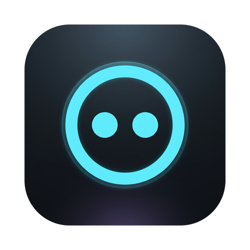

# Tap That Mac



A native macOS app that turns deliberate double taps and knocks into actions. Its main window stays available from the Dock while recognition follows the selected operating mode. Built with Swift, SwiftUI and AppKit; no third-party package dependencies.

The current on-Mac detection is the working POC baseline. Set one **Double-tap action** in Actions: Ring, Lock Mac, media controls, or an experimental ChatGPT control. Existing lock, quick-action and assistant preferences migrate automatically. Triple-tap recognition is disabled in production.

Ring reveals every action. A single tap advances clockwise after the double-tap window; a double-tap chooses the highlighted action without advancing first. The default window is 450 ms and calibration can extend it to match a slower natural cadence. Arrow keys cycle through actions and wrap around. Return chooses, Escape cancels, and pointer selection works too. A separate ring preview never executes actions. Direct Lock Mac and Play / Pause show the ring, swing the highlight to the command, and animate a press before executing (about 620 ms total). Choosing an action in the open ring shows a 220 ms press before execution. Escape or losing focus cancels the pending action. Trackpad haptic feedback acknowledges the request on supported hardware; a confirmation appears after unlocking when macOS confirmed the lock. macOS may cover the ring as soon as the screen locks.

A quiet chime acknowledges each confirmed ring choice, including automatic Lock Mac and Play / Pause. Hovering and moving the highlight remain silent. Confirmation keeps the ring steady and emphasizes the center icon without restarting the highlight's motion; the chime acknowledges the choice, not successful execution.

The ring uses Apple's native Liquid Glass material (NSGlassEffectView) on macOS 26 and newer, so it inherits the macOS 27 Liquid Glass refinements automatically, and the same glassy, blurred AppKit material on macOS 14 and 15. Reduce Motion and Reduce Transparency are respected.

## Develop

Requires an Apple Silicon Mac, macOS 14+, and Xcode 16 or newer with a Swift 6 toolchain. The package deliberately uses Swift 5 language mode. Sensor support depends on the Mac's accelerometer and permissions; compiling does not establish hardware compatibility.

```sh
swift build
swift test
swift build -c release
open Package.swift
```

Open `Package.swift` in Xcode for editing and debugging. Use the bundled app for permission and helper testing; the command-line executable does not reproduce its signing identity or resources.

```sh
bash scripts/build-app.sh
open "dist/Tap That Mac.app"
```

Create `scripts/signing.env` (git-ignored) with your identity and team, and the build picks it up:

```sh
SIGNING_IDENTITY='Apple Development: Your Name (CERTIFICATE_ID)'
TEAM_ID='YOURTEAMID'
```

Explicit environment variables still override the file. Use a consistent signing identity and installation path to retain macOS permission grants. Supply your own certificate and team. Omitting them produces an ad-hoc development bundle that cannot use the signed helper. After a successful build the script replaces `/Applications/Tap That Mac.app` with the fresh bundle; set `SKIP_APP_INSTALL=1` to skip that install.

See [Contributing](CONTRIBUTING.md) for the development loop and [distribution](docs/DISTRIBUTION.md) for packaging.

## Try the baseline

The Live view gives permission guidance when access is missing. Accessibility enables system actions; Input Monitoring enables suppression near typing. Direct sensor access is tried first; the signed helper may require approval in System Settings. Sensor reconnection is available in Live.

1. Choose **Active**, **Test**, or **Paused** in the main window. Active runs configured actions; Test recognizes without executing; Paused stops recognition and sampling.
2. Watch the Live graph while tapping twice. Opening, closing, minimizing, or focusing the window does not change the selected mode.
3. In **Actions**, choose the double-tap behavior. To use the ring, double-tap to open, tap to move, and double-tap to choose.

The app uses 800 Hz for normal operation. CLI and test overrides remain available for development, including the existing restriction that rates below 50 Hz cannot execute actions. Motion capture, replay, and diagnostic export primitives remain available to development tools; Tap That Mac does not expose a recordings screen.

Reliable desk detection, left/right classification, broad hardware coverage and significant whole-app CPU savings at lower rates are not established. The graph displays motion, not proof that every peak qualifies as a gesture.

## Personal calibration

Choose **Calibrate…** in Live and select an open Mac on a desk or a closed Mac using an active external display. Use separate profiles for these setups; select the matching profile when switching. Lap use is outside scope.

Calibration takes about two minutes. It records everyday desk activity and leg/table movement, then light taps and knocks, both singly and in pairs. A fresh round verifies the fitted settings without changing them. Valid captures advance automatically; only a verified profile is applied automatically. Actions remain blocked during collection and review. Failed calibration leaves existing settings unchanged.

The live graph shows the broad motion envelope in cyan and the light-tap impulse in violet, with their separate gates. The ring acknowledges a pending tap while waiting to distinguish a single from a double. The detector accepts configured floors down to 0.002 g, preserves fast 120–130 ms pairs in generated tests, and waits for pending pulse confirmation before expiring a pair.

Sessions are saved locally under `~/Library/Application Support/Tap That Mac/Calibration/` with unique filenames and per-window checkpoints. Previous local settings and calibration archives are preserved during the rename; see [upgrade details](docs/DISTRIBUTION.md#upgrading-from-the-previous-name). Nothing is uploaded. Generated regression tests and short calibration do not establish real-world desk reliability. See the [design and limits](docs/DETECTION-CALIBRATION.md) and [CNN reassessment](docs/CNN-REASSESSMENT.md).

## Layout

| Path | Purpose |
| --- | --- |
| `Sources/TapCore` | Sensor decoding, buffered input, pulse detection, gesture routing, replay and shared models |
| `Sources/TapThatMac` | macOS app, Live and Actions views, graph, command ring and action execution |
| `Sources/TapSensorHelper` | Authenticated sensor helper |
| `Sources/SensorProbe` | Read-only hardware diagnostic executable |
| `Sources/ReplayCaptures` | Labeled recording replay CLI |
| `Tests/TapCoreTests` | Deterministic generated-signal, collection, calibration and interaction tests |
| `Packaging` | Bundle metadata, app icon and DMG artwork |
| `scripts` | Validation, app bundling and distribution |

[First-principles detection and calibration](docs/DETECTION-CALIBRATION.md) describes the design, implemented quality checks, and remaining algorithm experiments. Historical captured fixtures and their accuracy claims have been removed.

## Attribution

Sensor report decoding and initialization were informed by [apple-silicon-accelerometer](https://github.com/olvvier/apple-silicon-accelerometer). Its [MIT notice](docs/SENSOR_REFERENCE_LICENSE.txt) is preserved and bundled. This notice applies to the referenced work; this repository does not declare a project-wide open-source license.
